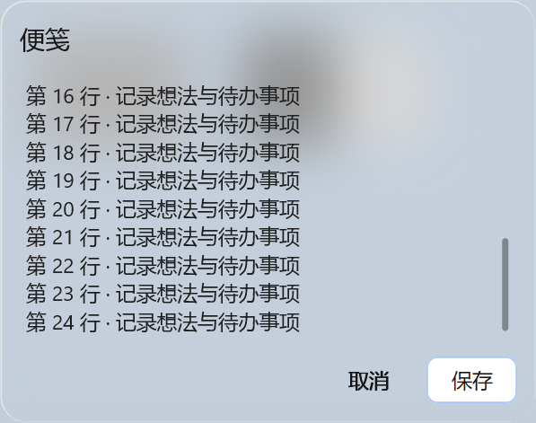
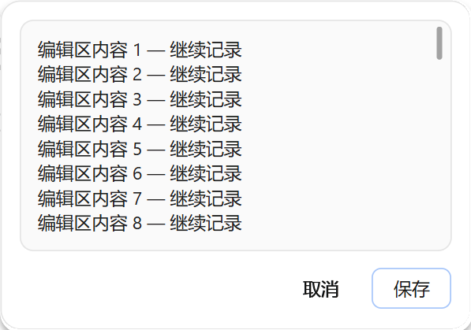
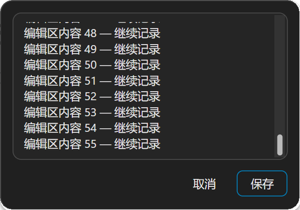

# 原生亚克力与滚动条

日期：2026-11-04。Windows x64 发行版本：[`45.0.0-cloudbypass.7`](https://github.com/ChengHoward/edist/releases/tag/v45.0.0-cloudbypass.7)。状态：**发行验收通过**。`.7` 首次提供 Textarea，以及本页的 `backgroundMaterial`、`scrollbarPlacement` 和滚动条样式；`.6` 不包含这些新增能力。`.6` 及早期便笺的历史验收记录保持原样。

## NativePanel 系统材质

创建面板或调用 `panel.update()` 时可指定 `backgroundMaterial`：

- `none`：默认值，使用原有普通背景。
- `acrylic`：请求 Windows 的 Desktop Acrylic 系统背景材质。更新时省略该字段，保留当前请求。

此选项仅作用于 NativePanel，菜单 `Menu` 本轮不增加材质配置。面板继续使用原生 Views 控件，不为材质创建 WebContents、网页或额外渲染器。

系统材质要求 Windows 11 22H2 或更新版本，即 Build 22621 及以上。本实现请求用于短时窗口的系统背景类型，不提供任意设置 DWM 透明度、模糊强度或噪点的参数。Windows 可随版本调整实际材质效果。具体系统背景类型和最低版本见微软 [DWM_SYSTEMBACKDROP_TYPE](https://learn.microsoft.com/en-us/windows/win32/api/dwmapi/ne-dwmapi-dwm_systembackdrop_type)。

关闭系统透明效果、节电、高对比度、硬件或系统策略限制以及窗口失活，都可能使系统材质呈现为纯色。`theme.background` 提供无法使用材质时的后备背景色，不能通过它保证任意系统材质 alpha。程序不修改用户的系统透明度设置，也不保证窗口失活后继续模糊。系统的适应行为见微软 [Acrylic material](https://learn.microsoft.com/en-us/windows/apps/design/style/acrylic)。

宿主为根容器或子控件指定不透明背景时，该区域会盖住下方材质。下面的根容器不设置不透明背景，编辑器采用 `borderless`；文本颜色仍须适合当前主题。

## 主进程示例

```js
const { app, BrowserWindow, NativePanel } = require('electron')

app.whenReady().then(() => {
  const parent = new BrowserWindow({ width: 900, height: 650 })
  if (!NativePanel.isSupported()) return

  const panel = new NativePanel({
    parent,
    backgroundMaterial: 'acrylic',
    scrollbarPlacement: 'gutter',
    theme: { mode: 'light', background: '#FAFAFA', text: '#171717' },
    focusMode: 'input',
    content: {
      type: 'column',
      id: 'note',
      width: 340,
      gap: 10,
      children: [
        { type: 'text', id: 'heading', text: '便笺' },
        {
          type: 'textarea',
          id: 'body',
          value: Array.from({ length: 30 }, (_, index) => `第 ${index + 1} 行`).join('\n'),
          height: 180,
          submitOnEnter: false,
          scrollbarPlacement: 'overlay',
          style: { borderless: true, paddingTop: 8, paddingLeft: 8, paddingRight: 16 }
        },
        { type: 'button', id: 'done', text: '完成', variant: 'plain' }
      ]
    }
  })

  panel.on('action', (action) => {
    if (action.id === 'done' && action.type === 'click') panel.hide()
  })

  panel.show({
    anchorBounds: { x: 400, y: 180, width: 24, height: 24 },
    placement: 'bottom-start'
  })
})
```

切换普通背景时调用 `panel.update({ backgroundMaterial: 'none' })`；切回系统材质时传入 `acrylic`。`backgroundMaterial` 只接受这两个字符串，布尔值、数字、其他枚举或未知字段均不接受。与内容、主题、位置等字段一同更新时，整份 patch 校验通过后才修改原生状态。

## 统一细滚动条

本轮源码将列表、面板外层溢出区与多行编辑器的默认滚动条统一为无箭头样式：12 DIP 交互滚动槽，灰色圆头滑块正常宽 4 DIP，悬停或按下时宽 6 DIP，最短长度 24 DIP。轨道平时透明，交互时使用淡色背景，滑块和轨道适配浅色与深色主题；强制色模式采用系统配色。内容可完整显示时不显示滚动条。

滚动条只在内容溢出时显示，编辑器外框宽高保持不变。视觉滑块虽细，仍保留 12 DIP 宽的交互区域。Textarea 的滚动槽外沿位于边框厚度加 2 DIP 的内侧，独立于四边文字 padding；可见滑块在槽中居中，所以滑块与边框之间还包含槽内留白。文字的 `paddingRight` 不再把整个滚动槽向内推。

`scrollbarPlacement` 只接受两个字符串，默认均为 `gutter`：

- `gutter`：在文字或列表视口旁保留滚动槽，不覆盖内容。Textarea 先复用已有右侧 padding，只补足不足的空间，不会在足够留白上再额外叠加一整段 12 DIP。
- `overlay`：不扣除视口宽度，将滚动条叠放在内容上方；可能覆盖文字，宿主需要避让时应自行留足右侧文字留白，计入滚动槽及边缘间隔。

顶层创建选项及 `panel.update({ scrollbarPlacement })` 只控制面板外层溢出区；`list`、`textarea` 节点通过各自的同名字段配置，独立默认 `gutter`，不继承顶层值。修改节点配置时通过 `update({ content })` 提交完整内容树，并保留稳定 id。其他节点和 `style.scrollbarPlacement` 不接受该字段。

仅更新尺寸、样式或滚动条布局时，在 `textarea` 节点省略 `value`，保留当前原生草稿；显式传入 `value` 表示宿主提供正文。保留 id 和类型不能代替对显式正文的处理，避免把宿主尚未同步的旧字符串随布局更新再次提交。

两种模式始终位于控件已分配的边界与可见边框内，不伸出窗口，也不在相邻控件上绘制。`gutter` 的“独立槽位”指内容视口旁的区域，并非视觉边框外的浮动滚动条。上方示例为外层选用 `gutter`、编辑器显式选用 `overlay` 并保留右侧文字留白。

滚动仍使用原生拖动、滚轮及键盘交互。多行编辑器正文在固定高度内滚动；上下键继续移动文本光标或选区，不用于菜单行跳转。本轮没有新增滚动条尺寸字段，不改变进程级滚动条，也不修改 Menu 的滚动条。

## 实机截图

以下图片均来自本次最终可执行文件，使用 Windows x64、单显示器、175% 缩放。便笺正文及背景为测试数据，截图副本和校验值保存在同目录的[验收摘要](./images/native-acrylic-preview-2026-11/verification.json)。

浅色与深色亚克力便笺，包含原生多行编辑区和底部按钮：




普通背景下的 Textarea 滚动条，展示靠近边框的细圆头滑块：





布局对照：[浅色 gutter](./images/native-acrylic-preview-2026-11/textarea-placement-gutter-light.png)、[浅色 overlay](./images/native-acrylic-preview-2026-11/textarea-placement-overlay-light.png)、[深色 gutter](./images/native-acrylic-preview-2026-11/textarea-placement-gutter-dark.png)、[深色 overlay](./images/native-acrylic-preview-2026-11/textarea-placement-overlay-dark.png)。示例正文较短，图片中的差别不明显；实机几何断言验证了右侧文字留白较小时，`overlay` 保留更宽正文视口，滚动条和编辑框的位置不变。留白较大时，`gutter` 复用现有留白，两种模式也可以得到相同视口。

其他实测：[浅色列表](./images/native-acrylic-preview-2026-11/scrollbar-list-light.png)、[深色列表](./images/native-acrylic-preview-2026-11/scrollbar-list-dark.png)、[浅色外层溢出区](./images/native-acrylic-preview-2026-11/scrollbar-outer-light.png)、[深色外层溢出区](./images/native-acrylic-preview-2026-11/scrollbar-outer-dark.png)，以及材质纹理采样的[浅色](./images/native-acrylic-preview-2026-11/acrylic-light.png)和[深色](./images/native-acrylic-preview-2026-11/acrylic-dark.png)截图。

## 编译与验收

最终构建产物为 `D:/electron/main/src/out/Release/electron.exe`，Windows x64 Release，SHA-256：

```text
bbd02f3fed48537a5a1b7f66d313a7a73a64cfb20e80f74aea35898e4809b468
```

本轮最终产物的运行检查 **135/135** 通过：中文完整场景 40/40、子进程高对比度场景 1/1、既有面板与 PageInfo 42/42、Agent／可信输入／点击定位 46/46、英文 3/3、阿拉伯语 3/3。另有最终 JS 封装的隔离 schema 校验 **126/126** 通过，分为材质 42/42 与滚动条位置 84/84；公开类型生成、TS smoke 及 GN 依赖检查通过。

本机 Windows Build 26100 下，浅色和深色实际读回 DWM 属性 38 的值均为 `3`，对应系统短时窗口材质。参考纹理实测的相对高频指标约为 `0.118`，同时保留低频背景变化，用于核对本次会话确有模糊合成；验收不只检查接口请求是否被接受。原始系统状态和纹理采样记录见验收摘要。

首轮定向 probe 为 6/7，Textarea 滚轮场景的起点处于正文底部；测试夹具通过 Ctrl+A 后 Left 回到开头再验证，最终运行全部通过，首轮保存在 `probe-initial/`。英文首次运行 2/3，同一可执行文件、同一夹具重新运行后为 3/3，首轮保存在 `en-US-initial/`，未删除失败记录。

完整报告目录为 `D:/electron/edist-publish/native-acrylic-preview-20261104/`。最终运行和摘要见 `final-run.json`、`verification.json`，类型记录见 `types-final.log`，GN 记录见 `gn-check-final.log`。`verify-schema.cjs` 可重新运行两组 schema 校验，`schema-verification-manifest.json` 记录源码、校验脚本和结果文件的 SHA-256。

## 发行包与安装验证

从 `http://127.0.0.1:8787/electron/` 本地镜像实际安装 `.7` npm 包后，运行、公开类型及 6 项材质／滚动条界面检查通过；安装所得可执行文件与上述 SHA-256 完全相同，ABI 为 `150`。本轮 ZIP 直接打包已验收的运行文件，未重新链接；包内二进制和六项资源摘要均逐项核对。

- ZIP SHA-256：`89e2159eafe721cc14e99b3392ae2fa6a417e1002cdb19791f62a1f9cbae6402`。
- npm 包 SHA-256：`ffb0515f9e881f2336ae5066d8346a740640129181fdcae392bb13b237797d6b`。
- 分发版本：`45.0.0-cloudbypass.7`；内部上游版本：`45.0.0-beta.5`。
- [发行构建记录](https://github.com/ChengHoward/edist/releases/download/v45.0.0-cloudbypass.7/native-ui-build-manifest.json)记录源码提交、发行附件、安装和类型校验；附件同时提供完整文档与截图。

安装验证目录为 `D:/electron/edist-publish/native-ui-release-45.0.0-cloudbypass.7/`。安装 smoke 的首轮诊断方法名笔误已修正并保留日志；没有因此修改或替换发行包。本轮仅提供 Windows x64 发行包。

## 接口与实测边界

创建和更新字段分别见 [NativePanelConstructorOptions](../api/structures/native-panel-options.md) 与 [NativePanelUpdateOptions](../api/structures/native-panel-update-options.md)。编辑器见 [原生多行便笺](./原生多行便笺.md)，通用生命周期见 [NativePanel](../api/native-panel.md)。

高对比度检查仅对测试子进程传入 `--force-high-contrast`，验证该路径的纯色后备和系统色，没有修改 Windows 全局设置。旧版 Windows、节电状态及系统透明度开关没有逐项切换实测；窗口失活后的模糊效果由 Windows 决定。多显示器、混合 DPI、其他输入法、额外硬件和读屏器没有对应设备实测时，不视为已覆盖。

材质 schema 42 项覆盖默认 `none`、严格枚举、双向切换、主题更新保留请求和非法同批字段的原子拒绝；位置 schema 84 项覆盖默认 `gutter`、两种布局、节点独立配置、错误字段及材质兼容。这些校验隔离运行 JS 封装，不代替原生窗口或系统材质测试；原始结果分别为 `material-schema-validation.json` 和 `scrollbar-placement-schema-validation.json`。
