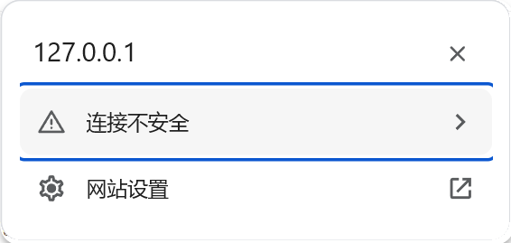
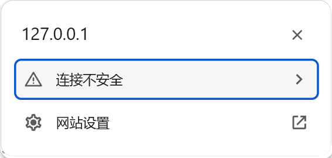
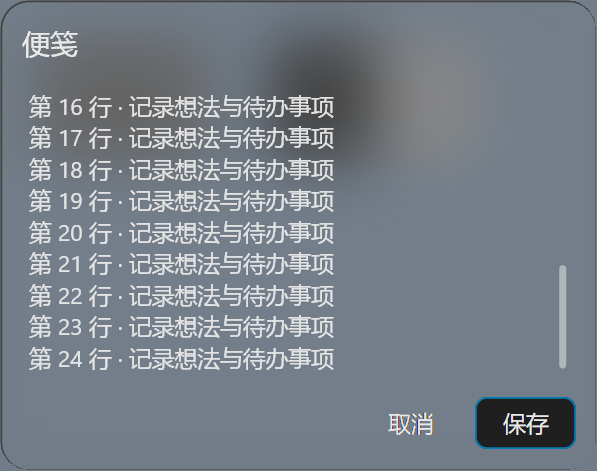
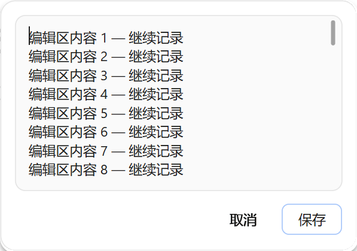

# 原生亚克力与滚动条

日期：2026-11-04。Windows x64 发行版本：[`45.0.0-cloudbypass.7`](https://github.com/ChengHoward/edist/releases/tag/v45.0.0-cloudbypass.7)。状态：**发行验收通过**。本页对应 `.7` 的同版本焦点框修订，版本号保持不变；请以本页二进制 SHA-256 区分首发构建与修订构建。`.7` 提供 Textarea、`backgroundMaterial`、`scrollbarPlacement` 和细滚动条；`.6` 不包含这些新增能力。早期便笺及 `.6` 的历史记录保持原样。

## NativePanel 系统材质

创建面板或调用 `panel.update()` 时可指定 `backgroundMaterial`：

- `none`：默认值，使用原有普通背景。
- `acrylic`：请求 Windows 的 Desktop Acrylic 系统背景材质。更新时省略该字段，保留当前请求。

此选项仅作用于 NativePanel，菜单 `Menu` 本轮不增加材质配置。面板继续使用原生 Views 控件，不为材质创建 WebContents、网页或额外渲染器。

系统材质要求 Windows 11 22H2 或更新版本，即 Build 22621 及以上。本实现请求用于短时窗口的系统背景类型，不提供任意设置 DWM 透明度、模糊强度或噪点的参数。Windows 可随版本调整实际材质效果。具体系统背景类型和最低版本见微软 [DWM_SYSTEMBACKDROP_TYPE](https://learn.microsoft.com/en-us/windows/win32/api/dwmapi/ne-dwmapi-dwm_systembackdrop_type)。

关闭系统透明效果、节电、高对比度、硬件或系统策略限制以及窗口失活，都可能使系统材质呈现为纯色。`theme.background` 提供无法使用材质时的后备背景色，不能通过它保证任意系统材质 alpha。程序不修改用户的系统透明度设置，也不保证窗口失活后继续模糊。系统的适应行为见微软 [Acrylic material](https://learn.microsoft.com/en-us/windows/apps/design/style/acrylic)。

宿主为根容器或子控件指定不透明背景时，该区域会盖住下方材质。下面的根容器不设置不透明背景，编辑器采用 `borderless`；文本颜色仍须适合当前主题。

## 主进程示例

```js
const { app, BrowserWindow, NativePanel } = require('electron')

app.whenReady().then(() => {
  const parent = new BrowserWindow({ width: 900, height: 650 })
  if (!NativePanel.isSupported()) return

  const panel = new NativePanel({
    parent,
    backgroundMaterial: 'acrylic',
    scrollbarPlacement: 'gutter',
    theme: { mode: 'light', background: '#FAFAFA', text: '#171717' },
    focusMode: 'input',
    content: {
      type: 'column',
      id: 'note',
      width: 340,
      gap: 10,
      children: [
        { type: 'text', id: 'heading', text: '便笺' },
        {
          type: 'textarea',
          id: 'body',
          value: Array.from({ length: 30 }, (_, index) => `第 ${index + 1} 行`).join('\n'),
          height: 180,
          submitOnEnter: false,
          scrollbarPlacement: 'overlay',
          style: { borderless: true, paddingTop: 8, paddingLeft: 8, paddingRight: 16 }
        },
        { type: 'button', id: 'done', text: '完成', variant: 'plain' }
      ]
    }
  })

  panel.on('action', (action) => {
    if (action.id === 'done' && action.type === 'click') panel.hide()
  })

  panel.show({
    anchorBounds: { x: 400, y: 180, width: 24, height: 24 },
    placement: 'bottom-start'
  })
})
```

切换普通背景时调用 `panel.update({ backgroundMaterial: 'none' })`；切回系统材质时传入 `acrylic`。`backgroundMaterial` 只接受这两个字符串，布尔值、数字、其他枚举或未知字段均不接受。与内容、主题、位置等字段一同更新时，整份 patch 校验通过后才修改原生状态。

## 统一细滚动条

本轮源码将列表、面板外层溢出区与多行编辑器的默认滚动条统一为无箭头样式：12 DIP 交互滚动槽，灰色圆头滑块正常宽 4 DIP，悬停或按下时宽 6 DIP，最短长度 24 DIP。轨道平时透明，交互时使用淡色背景，滑块和轨道适配浅色与深色主题；强制色模式采用系统配色。内容可完整显示时不显示滚动条。

滚动条只在内容溢出时显示，编辑器外框宽高保持不变。视觉滑块虽细，仍保留 12 DIP 宽的交互区域。Textarea 的滚动槽外沿位于边框厚度加 2 DIP 的内侧，独立于四边文字 padding；可见滑块在槽中居中，所以滑块与边框之间还包含槽内留白。文字的 `paddingRight` 不再把整个滚动槽向内推。

`scrollbarPlacement` 只接受两个字符串，默认均为 `gutter`：

- `gutter`：在文字或列表视口旁保留滚动槽，不覆盖内容。Textarea 先复用已有右侧 padding，只补足不足的空间，不会在足够留白上再额外叠加一整段 12 DIP。
- `overlay`：不扣除视口宽度，将滚动条叠放在内容上方；可能覆盖文字，宿主需要避让时应自行留足右侧文字留白，计入滚动槽及边缘间隔。

顶层创建选项及 `panel.update({ scrollbarPlacement })` 只控制面板外层溢出区；`list`、`textarea` 节点通过各自的同名字段配置，独立默认 `gutter`，不继承顶层值。修改节点配置时通过 `update({ content })` 提交完整内容树，并保留稳定 id。其他节点和 `style.scrollbarPlacement` 不接受该字段。

仅更新尺寸、样式或滚动条布局时，在 `textarea` 节点省略 `value`，保留当前原生草稿；显式传入 `value` 表示宿主提供正文。保留 id 和类型不能代替对显式正文的处理，避免把宿主尚未同步的旧字符串随布局更新再次提交。

两种模式始终位于控件已分配的边界与可见边框内，不伸出窗口，也不在相邻控件上绘制。`gutter` 的“独立槽位”指内容视口旁的区域，并非视觉边框外的浮动滚动条。上方示例为外层选用 `gutter`、编辑器显式选用 `overlay` 并保留右侧文字留白。

滚动仍使用原生拖动、滚轮及键盘交互。多行编辑器正文在固定高度内滚动；上下键继续移动文本光标或选区，不用于菜单行跳转。本轮没有新增滚动条尺寸字段，不改变进程级滚动条，也不修改 Menu 的滚动条。

## 同版本焦点框修订

PageInfo 的整行操作和 NativePanel 图标按钮原先沿用默认向外扩展 3 DIP 的焦点环，圆角也没有与行背景同步；越出控件边界的轮廓会被滚动视口裁剪，导致蓝色边线不完整。修订仍使用 Chromium 原生 `FocusRing`，改为向内收 1 DIP、线宽 2 DIP，圆角跟随 `style.radius`；更新图标按钮半径时同步更新焦点轮廓。

鼠标点击、Tab、方向键及 Enter／Space 激活行为继续保留。本次修订没有新增焦点 API，也不通过取消焦点来隐藏轮廓。

前后对照使用相同的焦点检查夹具：首发 `.7` 的 3 项焦点像素检查全部复现失败，新可执行文件的同组检查 **3/3** 通过。后续修正另存为驱动后的最终完整验收包含同名焦点项，并全部通过。对照夹具 SHA-256 为 `4a704b35a8981f25d74a1206e557f8d9ad0dcb621f9cbfe49c93f92e07b408b0`，最终夹具 SHA-256 为 `98d536a7b939d984307ea9c2640ecf47d243f5611e81a2802009ebe043b44ae1`；两者独立记录，不要求字节相同。初次复现和修订结果分别保存在 `initial-reproduction-final/`、`focus-targeted-final/`。

浅色 PageInfo 鼠标焦点，修订前与修订后：





深色对照：[修订前](./images/native-focus-fix-2026-11/before-focus-page-info-dark-mouse.png)、[修订后](./images/native-focus-fix-2026-11/focus-page-info-dark-mouse.png)。

整行项目：[light-before](./images/native-focus-fix-2026-11/focus-rows-light-before.png)、[light-mouse](./images/native-focus-fix-2026-11/focus-rows-light-mouse.png)、[light-tab](./images/native-focus-fix-2026-11/focus-rows-light-tab.png)、[dark-before](./images/native-focus-fix-2026-11/focus-rows-dark-before.png)、[dark-mouse](./images/native-focus-fix-2026-11/focus-rows-dark-mouse.png)、[dark-tab](./images/native-focus-fix-2026-11/focus-rows-dark-tab.png)。

图标按钮：[light-before](./images/native-focus-fix-2026-11/focus-icon-light-before.png)、[light-radius-4](./images/native-focus-fix-2026-11/focus-icon-light-radius-4.png)、[light-radius-14](./images/native-focus-fix-2026-11/focus-icon-light-radius-14.png)、[dark-before](./images/native-focus-fix-2026-11/focus-icon-dark-before.png)、[dark-radius-4](./images/native-focus-fix-2026-11/focus-icon-dark-radius-4.png)、[dark-radius-14](./images/native-focus-fix-2026-11/focus-icon-dark-radius-14.png)。

PageInfo：[light-before](./images/native-focus-fix-2026-11/focus-page-info-light-before.png)、[light-mouse](./images/native-focus-fix-2026-11/focus-page-info-light-mouse.png)、[light-tab](./images/native-focus-fix-2026-11/focus-page-info-light-tab.png)、[light-security](./images/native-focus-fix-2026-11/focus-page-info-light-security.png)、[dark-before](./images/native-focus-fix-2026-11/focus-page-info-dark-before.png)、[dark-mouse](./images/native-focus-fix-2026-11/focus-page-info-dark-mouse.png)、[dark-tab](./images/native-focus-fix-2026-11/focus-page-info-dark-tab.png)、[dark-security](./images/native-focus-fix-2026-11/focus-page-info-dark-security.png)。

## 实机截图

以下材质、滚动条及焦点截图均来自本次最终可执行文件；明确标为“修订前”的两张图来自首发 `.7`。测试环境为 Windows x64、单显示器、175% 缩放。便笺正文及背景是测试数据，当前截图与摘要保存在新的[验收目录](./images/native-focus-fix-2026-11/verification.json)，首发图片目录保持冻结。

浅色与深色亚克力便笺，包含原生多行编辑区和底部按钮：




普通背景下的 Textarea 滚动条，展示靠近边框的细圆头滑块：




布局对照：[浅色 gutter](./images/native-focus-fix-2026-11/textarea-placement-gutter-light.png)、[浅色 overlay](./images/native-focus-fix-2026-11/textarea-placement-overlay-light.png)、[深色 gutter](./images/native-focus-fix-2026-11/textarea-placement-gutter-dark.png)、[深色 overlay](./images/native-focus-fix-2026-11/textarea-placement-overlay-dark.png)。示例正文较短，图片中的差别不明显；实机几何断言验证了右侧文字留白较小时，`overlay` 保留更宽正文视口，滚动条和编辑框的位置不变。留白较大时，`gutter` 复用现有留白，两种模式也可以得到相同视口。

其他实测：[浅色列表](./images/native-focus-fix-2026-11/scrollbar-list-light.png)、[深色列表](./images/native-focus-fix-2026-11/scrollbar-list-dark.png)、[浅色外层溢出区](./images/native-focus-fix-2026-11/scrollbar-outer-light.png)、[深色外层溢出区](./images/native-focus-fix-2026-11/scrollbar-outer-dark.png)，以及材质纹理采样的[浅色](./images/native-focus-fix-2026-11/acrylic-light.png)和[深色](./images/native-focus-fix-2026-11/acrylic-dark.png)截图。

## 编译与验收

本次修订的最终构建产物为 `D:/electron/main/src/out/Release/electron.exe`，Windows x64 Release，SHA-256：

```text
c737bce9ba686cd08a63511a8c9b8c80edc001209895867b2c6cc0847c70518a
```

本次最终产物的运行检查 **138/138** 通过：中文完整场景 43/43、子进程高对比度场景 1/1、既有面板与 PageInfo 42/42、Agent／可信输入／点击定位 46/46、英文 3/3、阿拉伯语 3/3。最终 JS 封装的隔离 schema 校验 **126/126** 通过，分为材质 42/42 与滚动条位置 84/84；公开类型生成、TS smoke 及 GN 依赖检查通过。

早期证书另存为测试出现过桌面遮挡，以及原生文件名框实际内容缺字；旧 `.7` 对照也读到了非法路径。输入与自动完成之间存在时序竞争仍是推断，没有将其当作已证实的系统根因。最终只在测试驱动的证书路径输入中采用短间隔 `SendInput`，并通过原生 Edit 完整读回路径、核对一致后才保存；PID／HWND 归属限制、真实格式导出和证书内容断言全部保留，没有修改发行接口或放宽产品断言。使用修正后的驱动，最终中文完整场景 43/43、英文 3/3、阿拉伯语 3/3通过。原始失败与诊断记录保存在 `pre-driver-fix-archive/`、`safe-window-rerun*/`、`old-baseline-control/` 和 `tls-diagnostic/`；初次失败及重跑对应关系见 `verification.json` 的 `initialAttempts`、`rerunRelation`。最终完整运行中的列表悬停检查出现一次悬停事件与绘制读回的时序失败；原始完整报告保留在 `final-verified/zh-CN-full/`，同一源码、驱动和可执行文件的该项定向补测通过。最终结果按 `caseProvenance` 保留原始运行与补测来源，没有为此重复运行整套验收。

本机 Windows Build 26100 下，浅色和深色实际读回 DWM 属性 38 的值均为 `3`，对应系统短时窗口材质。参考纹理实测的相对高频指标约为 `0.118`，同时保留低频背景变化，用于核对本次会话确有模糊合成。原始系统状态和纹理采样记录见本次验收摘要。

完整报告目录为 `D:/electron/edist-publish/native-focus-fix-20261104/`。最终运行和摘要见 `final-run.json`、`verification.json`；`verify-schema.cjs` 可重新运行两组 schema 校验，`schema-verification-manifest.json` 记录源码、校验脚本和结果文件的 SHA-256。首发构建的失败重跑流程保留在首发历史记录中，不作为新可执行文件的验收结果。

按模块运行、失败单项补测和发布验收步骤见 [原生界面测试流程](./原生界面测试流程.md)。

## 发行包与安装验证

从本地镜像 `http://127.0.0.1:8787/electron/` 实际安装本次 `.7` npm 包后，运行、公开类型及 **3/3** 项焦点框界面检查通过；安装所得可执行文件与上述 SHA-256 完全相同，ABI 为 `150`。ZIP 直接打包已验收的运行文件，未重新链接；包内二进制和 6 项资源摘要均逐项核对。此次安装采用 `focus` 范围，仅对本次修改的焦点框做界面复测；材质与滚动条的界面结论见完整构建验收。

- ZIP SHA-256：`3f2f0595baaab729f0a0cf7fe04cf356753078fab95a173663fd2242aa94f651`。
- npm 包 SHA-256：`6a943837891218f2e40fca0d14f0f7e84fd584d968b5053ecad3b44458fa5d57`。
- 分发版本：`45.0.0-cloudbypass.7`；内部上游版本：`45.0.0-beta.5`。
- [发行构建记录](https://github.com/ChengHoward/edist/releases/download/v45.0.0-cloudbypass.7/native-ui-build-manifest.json)记录修订源码提交、附件、安装和类型校验；附件同时提供文档和截图。此链接对应同版本发行入口，本页验收通过不等于远端附件已经完成覆盖。

安装验证目录为 `D:/electron/edist-publish/native-ui-refresh-45.0.0-cloudbypass.7-20261104/install/final/`。本次安装使用独立项目、npm 缓存与 Electron 下载缓存；仅提供 Windows x64 发行包。

由于版本号仍为 `.7`，已安装的依赖或锁文件不会自动识别本次修订。需要显式重新下载，并在安装工具保留旧锁定摘要时刷新对应依赖的锁文件与完整性信息；重新安装后核对本页 SHA-256。启用远程校验和时，`@electron/get` 会读取远程 `SHASUMS256.txt`，已有 ZIP 缓存若与新摘要不符会重新下载；前提是安装流程确实运行，并且取得新的远程摘要。本次验证没有清理其他项目或全局缓存。

## 首发 .7 历史记录

首发 `.7` 的运行验收为 135/135，可执行文件 SHA-256 为 `bbd02f3fed48537a5a1b7f66d313a7a73a64cfb20e80f74aea35898e4809b468`，ZIP SHA-256 为 `89e2159eafe721cc14e99b3392ae2fa6a417e1002cdb19791f62a1f9cbae6402`。这些结果仅对应首发构建，不作为本次修订的证明。原始[首发验收摘要](./images/native-acrylic-preview-2026-11/verification.json)、首发截图，以及[源码提交 `782f7d28c0e9` 对应的原始文档](https://github.com/ChengHoward/electron/blob/782f7d28c0e92aa670287a1592f51bb4868f9518/docs/zh/%E5%8E%9F%E7%94%9F%E4%BA%9A%E5%85%8B%E5%8A%9B%E4%B8%8E%E6%BB%9A%E5%8A%A8%E6%9D%A1.md)保留原样；早期 Textarea 和 `.6` 记录也不改写。

## 接口与实测边界

创建和更新字段分别见 [NativePanelConstructorOptions](../api/structures/native-panel-options.md) 与 [NativePanelUpdateOptions](../api/structures/native-panel-update-options.md)。编辑器见 [原生多行便笺](./原生多行便笺.md)，通用生命周期见 [NativePanel](../api/native-panel.md)。

高对比度检查仅对测试子进程传入 `--force-high-contrast`，验证该路径的纯色后备和系统色，没有修改 Windows 全局设置。旧版 Windows、节电状态及系统透明度开关没有逐项切换实测；窗口失活后的模糊效果由 Windows 决定。多显示器、混合 DPI、其他输入法、额外硬件和读屏器没有对应设备实测时，不视为已覆盖。

材质 schema 42 项覆盖默认 `none`、严格枚举、双向切换、主题更新保留请求和非法同批字段的原子拒绝；位置 schema 84 项覆盖默认 `gutter`、两种布局、节点独立配置、错误字段及材质兼容。这些校验隔离运行 JS 封装，不代替原生窗口或系统材质测试；原始结果分别为 `material-schema-validation.json` 和 `scrollbar-placement-schema-validation.json`。
