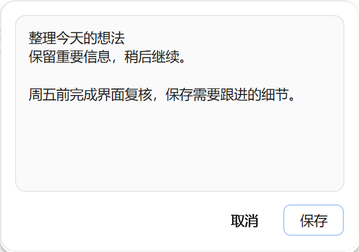
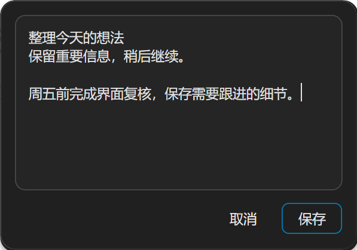

# 原生多行便笺

日期：2026-11-04。状态：**本地预览已完成编译，9 项新增实机检查及 115 项既有功能回归通过，尚未发布**。已发布的 Windows x64 `45.0.0-cloudbypass.6` 不包含本页新增的 `textarea` 或 `submitOnEnter`。本页不修改 `.6` 的验收和发行记录。

`NativePanel` 新增独立节点 `type: 'textarea'`，直接使用 Chromium Views Textarea，供多行便笺等原生输入场景使用。保留 `type: 'input'` 的单行语义；两种控件不是同一个节点上的可变模式，切换类型会替换控件。

## 输入与排版

- 默认 Enter 确认，发出 `submit`，`action.value` 是当前正文；Shift+Enter 换行。
- `submitOnEnter: false` 时，Enter 也换行；不额外增加 Ctrl+Enter 确认快捷键。
- 输入法组合期间由原生输入法处理 Enter，不以组合确认替代便笺提交。
- 正文自动折行；`height` 固定编辑区高度，超出后在编辑区内部滚动，不自动增高。
- `value`、`placeholder` 和 `maxLength` 沿用输入框字段。`maxLength` 为 `0` 表示不限制编辑长度，正整数表示 UTF-16 长度上限，可配置范围为 `0`～`65536`。传入配置中的字符串仍受通用的 65536 个 UTF-16 单元上限约束。
- `width`、`height` 和通用 `style` 控制大小、颜色、留白与边框。便笺使用较高内容区、淡边框和底部独立按钮。

`submitOnEnter` 只接受布尔值且只用于 `textarea`；`input` 不接受该字段，也不增加 `multiline`。未知字段、错误类型及非法长度在修改原生状态前拒绝。

## 主进程示例

宿主在 `change` 时维护草稿，Enter 提交时使用该次 `submit` 的正文；点击独立确认按钮时保存宿主草稿。确认、取消及存储逻辑由宿主决定，不增加表单值快照 API。

```js
const { app, BrowserWindow, NativePanel } = require('electron')

app.whenReady().then(() => {
  const parent = new BrowserWindow({ width: 900, height: 650 })
  if (!NativePanel.isSupported()) return

  let draft = ''
  const panel = new NativePanel({
    parent,
    focusMode: 'input',
    content: {
      type: 'column',
      id: 'note',
      width: 360,
      gap: 10,
      children: [
        {
          type: 'textarea',
          id: 'body',
          value: draft,
          placeholder: '写下便笺…',
          submitOnEnter: true,
          maxLength: 0,
          width: 360,
          height: 180,
          style: {
            borderColor: '#E5E5E5',
            borderWidth: 1,
            radius: 10,
            paddingTop: 10,
            paddingRight: 10,
            paddingBottom: 10,
            paddingLeft: 10
          }
        },
        {
          type: 'row',
          id: 'actions',
          gap: 8,
          children: [
            { type: 'text', id: 'spacer', text: '', flex: 1 },
            { type: 'button', id: 'cancel', text: '取消', variant: 'plain' },
            { type: 'button', id: 'save', text: '确认' }
          ]
        }
      ]
    }
  })

  panel.on('action', (action) => {
    if (action.id === 'body' && typeof action.value === 'string') {
      draft = action.value
    }
    if ((action.id === 'body' && action.type === 'submit') || (action.id === 'save' && action.type === 'click')) {
      console.log('保存便笺：', draft)
      panel.hide()
    }
    if (action.id === 'cancel' && action.type === 'click') panel.hide()
  })

  panel.show({
    anchorBounds: { x: 400, y: 180, width: 24, height: 24 },
    placement: 'bottom-start'
  })
})
```

更新同一便笺时保留 `body` 的 id 和 `textarea` 类型，以保留草稿、焦点与输入法状态。需要切换到另一份便笺时使用新 id，避免把旧草稿当成新内容。尺寸及样式字段见 [NativePanelContent](../api/structures/native-panel-content.md)，动作参数见 [NativePanelAction](../api/structures/native-panel-action.md)，生命周期见 [NativePanel](../api/native-panel.md)。

## 实机截图

以下两张图片直接采集自本次最终预览可执行程序，未修改截图内容。测试环境为 Windows x64、单显示器、175% 缩放；正文、便笺数据和按钮均为测试夹具内容。

浅色便笺：固定高度的淡边框编辑区与底部取消、保存按钮。



深色便笺：原生文字、边框及按钮跟随面板主题。



## 编译与测试

最终构建产物为 `D:/electron/main/src/out/Release/electron.exe`，Windows x64 Release。SHA-256：

```text
64c5e8fb4e13082722e9031cd35e6507a9224fccb8cb54a5299563e03d5b422c
```

本地预览编译已通过。原生便笺实机检查 **9/9** 通过，截图和交互报告对应上述同一个可执行文件，覆盖：

- 固定高度、实际折行以及浅色和深色截图；默认 Enter 提交完整多行正文、Shift+Enter 换行、宿主草稿驱动的保存与取消，以及 `submitOnEnter: false` 时的换行。
- 多行 UTF-16 长度限制、`maxLength: 0`、内容及主题更新后草稿、反向选区、光标与编辑视口保留；长正文内部滚动、上下键和 Tab 焦点移动。
- 中文输入法组合期间更新、第一次 Escape 取消组合及完成组合后提交；非法配置整体拒绝、无新增 WebContents，以及既有单行输入仍在 Enter 时提交且不插入换行。

最终输入法场景在第一次直接组合输入时即进入原生组合态并完成验证。首轮实机运行的三项失败保存在 `textarea-initial-attempt/`；校正测试驱动的扩展键标记与扫描码后，使用相同可执行文件完整重跑，最终 9/9 通过。

另有实际 JS 源码内容校验函数的 **75/75** 项隔离校验通过，覆盖有效多行文本、严格布尔值、UTF-16 长度、`maxLength: 0`、非法字段及单行输入兼容。公开类型生成、TS smoke 与六个 GN 目标检查通过。隔离 schema 校验不代替原生按键与输入法检查。

同一可执行文件的既有功能回归 **115/115** 通过：原有界面 21 项、面板与网站信息 42 项、Agent 11 项、可信输入 26 项、点击定位 9 项、英文与阿拉伯语各 3 项。加上本次多行便笺 9 项，共 **124/124** 项运行检查通过；这些是本次实际重跑的结果，没有沿用 `.6` 的旧验收结论。多显示器、混合 DPI、其他输入法、额外硬件及读屏器没有对应实测时不视为通过。

测试原始记录目录：`D:/electron/edist-publish/native-textarea-preview-20261104/`。最终实机报告为 `textarea/results.json`，源码 schema 报告为 `schema-validation.json`；[验收摘要及文件校验值](./images/native-textarea-preview-2026-11/verification.json)与截图副本保存在 `docs/zh/images/native-textarea-preview-2026-11/`。本次没有更新本地镜像或 GitHub 发行包，仍为未发布的本地预览。
