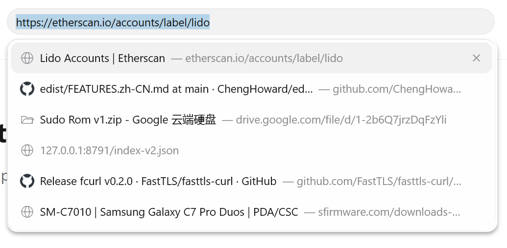
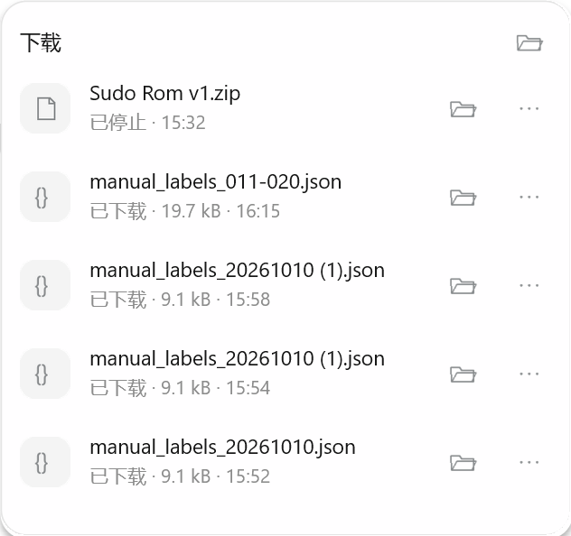
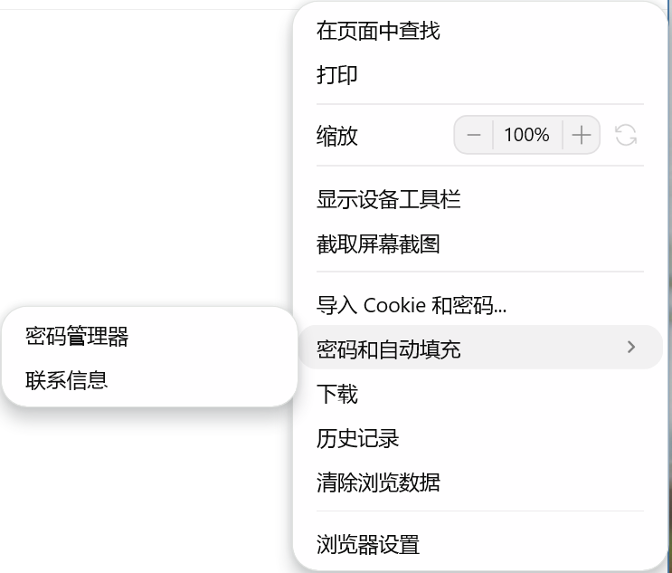
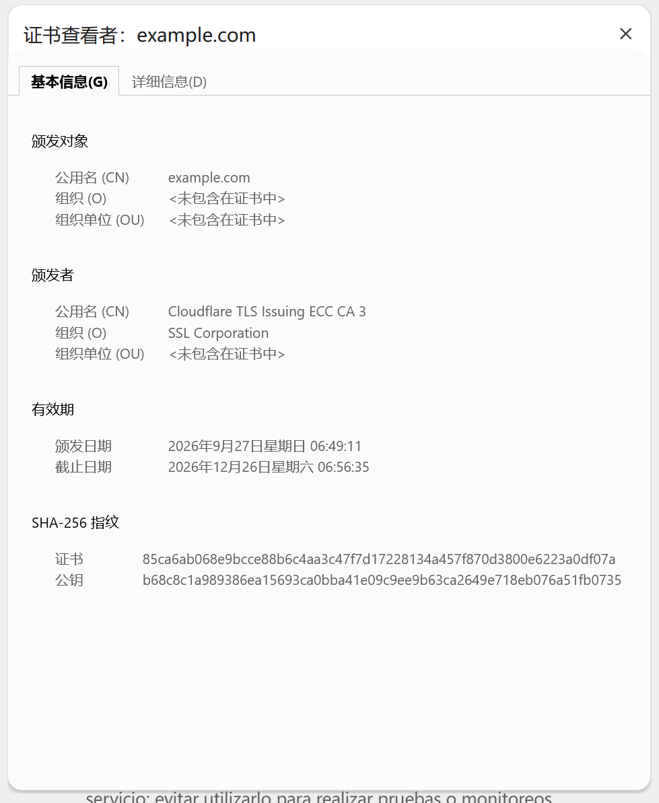
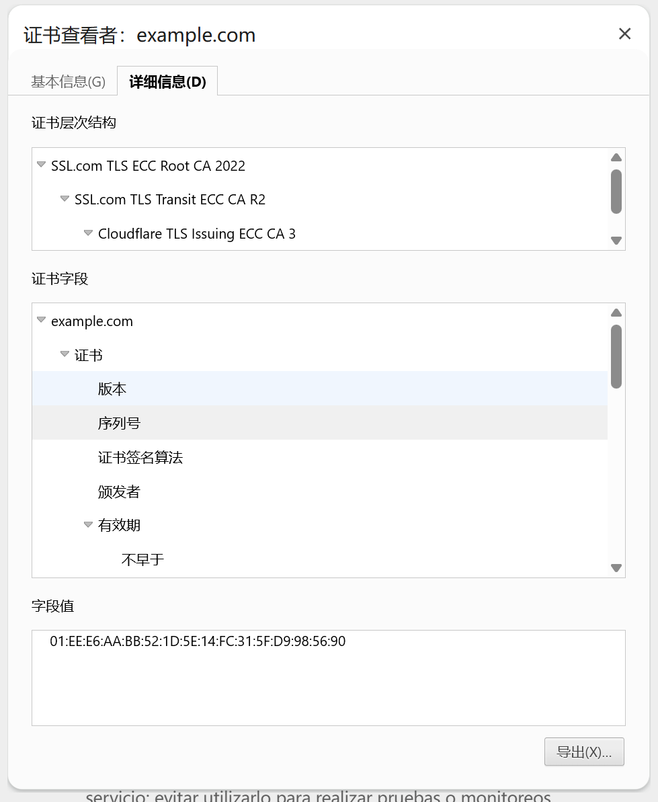

# 原生界面定制实现与测试

日期：2026-11-04。版本：[`45.0.0-cloudbypass.6`](https://github.com/ChengHoward/edist/releases/tag/v45.0.0-cloudbypass.6)。本轮菜单精调及完整本地预览已完成验收，结果见第 4 节，安装验证及附件见该版本发布记录。

本轮实现仅修改 Electron、Chromium 适配补丁、类型、测试和文档。Windows x64 `.5` 的历史发行物与原始验收保持原样，新增能力归入 `.6`；Linux x64 仍使用已有 `.2`，本次没有 Linux 或 macOS `.6` 包。需求与原始参考图见 [定制规划](./原生界面定制规划.md)，`.5` 的原始验收见 [原生浮层与网站信息](./原生浮层.md)。

## 1. 实现的方法与职责

### 网站信息

继续调用 `webContents.showPageInfoDialog(options)`，不增加另一套网站信息入口：

- 主面板：域名、关闭、连接安全入口、网站设置。
- 安全子页：返回、关闭、状态说明、原生行内帮助链接、证书入口。
- 证书查看器：基本信息、详细字段与证书链选择。显示实际 CN、O、OU、签发者、有效期、证书和公钥 SHA-256、算法、扩展及原始字段。只读，不修改系统信任或安装证书。
- 网站设置沿用 `page-info-open-site-settings`；宿主实现设置页面。本轮没有 Cookie 管理或完整权限设置页。

内置文字取自当前 Chromium 的 GRIT 资源和证书模型，没有自行维护中英文词典。应用启动前通过 `app.commandLine.appendSwitch('lang', 'zh-CN')` 或 `--lang=en-US` 指定语言，`app.whenReady()` 后使用 `app.getLocale()` 核对实际语言。资源包必须随可执行程序保留。自定义菜单、下载状态和地址建议的文字由宿主翻译。

网站信息主面板和安全子页使用原生 Views、Chromium 文字与图标。按用户最新要求，证书窗口改为 Chromium 原版 `chrome://view-cert` WebUI，复用未经重新设计的 HTML、CSS、TypeScript 及树控件；数据组装抽成 Chrome 和 Electron 共用的模块。原版层次树、字段树、字段值和导出取代了先前的顺序字段列表。

证书窗口单独增加一个专用 WebContents。它使用内部 WebUI 资源，不运行 Node 或宿主 preload；直接导航到资源 URL 不会获得原生对话框持有的证书参数和数据处理器。安全结论仍来自已提交文档的 SSL 状态，保留导航、重载、页面归属、权限重入和迟到操作检查。

### NativePanel

保留已有 `new NativePanel`、`isSupported()`、`show()`、`update()`、`hide()`、`destroy()` 和生命周期事件。新增能力通过内容字段启用：

- `item`：可点击的水平内容行。图标、文字、辅助文字和右侧按钮能共同组成一行；内部按钮独立回传动作，不执行整行。
- `iconButton`：纯图标按钮，要求真实 NativeImage 与可访问性名称。
- `button.variant`：`default`、`plain`、`outlined`；旧调用仍得到默认按钮。
- `style`：背景与交互状态颜色、边框、圆角、四边内边距、对齐、字体粗细、无边框输入。不是 CSS，不接受任意代码。
- `maxWidth`、`singleLine`、`highlights`：标题保持自然宽度，长标题设上限并省略，关键词按 UTF-16 范围加粗。
- `linkRange`：多行说明中一个原生超链接，周边普通文字不响应链接动作。
- `selected`：宿主控制选中行；从未选中变成选中时滚入可见区，不发出执行动作。
- `contentInset`：调整面板内容边距；地址建议使用较小内缩，下载面板可保留较宽留白。
- 列表与外层溢出区：15 DIP 轨道、9 DIP 灰色圆头滑块、上下箭头；正常、悬停、按下和深色分别绘制。使用 Chromium 原有 ScrollBar、BaseScrollBarThumb 和 ScrollBarButton 行为，不改变进程级滚动条或普通 Menu。

稳定 id 和类型的更新保留焦点、输入草稿、IME 组合状态及滚动位置。非法内容或样式在修改原生状态前整体拒绝。列表行可通过上下键移动原生焦点，Enter 确认。

地址建议使用 `focusMode: 'none'`。焦点及地址选区留在宿主输入框，宿主在输入法未组合时处理上下键、Enter 和 Esc，再用 `update()` 修改 `selected`。搜索、历史数据、异步结果排序、删除与跳转属于宿主业务。

本次详细地址参考中的独立删除占位、仅网址条目、自然标题后紧跟辅助网址，都通过布局与原生控件完成。测试程序中的图标和历史数据是本地示例，不代表新增了图标抓取或历史管理服务。

### Menu

菜单继续使用 `Menu.buildFromTemplate()`、`MenuItem` 和 Chromium `MenuRunner`，不创建 NativePanel：

- `menu.popup({ appearance })`：单次弹出的主题、字体、宽度、行高、圆角、内边距、悬停、分隔线和颜色。子菜单继承外观，`submenuWidth` 单独设置其最小宽度。
- `MenuItem.controls`：有限的原生 `button` 与 `label`，用 `group` 表示连续的分段背景；可设置图标、名称、禁用和 `closeOnClick`。
- `menu.refresh()`：更新打开期间的文字、图标与按钮可用状态；先校验全部配置，保持控件 id、类型、行和分组结构不变。
- 根 Menu 的 `control-action`：参数是 `{ itemId, controlId }`，没有额外的 Electron event 参数。不会执行所在菜单项的普通 `click` 回调。
- `menu.closePopup()`：继续沿用。普通命令仍按原生规则关闭；行内按钮默认保持打开，支持连续调整缩放。

定制菜单中，上下键和 Tab／Shift+Tab 遍历原生可操作项，跳过标签及禁用按钮；Enter／Space 执行，Esc 与左右键保留菜单层级行为。无 `appearance` 且无 `controls` 时保留原有菜单外观和导航。平台范围为 Windows；其他平台的 `appearance` 明确报错，跨平台宿主应按平台条件启用这些新增字段。

行内控件的个数、顺序、文字、图标和分组可以调整；本轮按钮为 24 × 24 DIP、标签为 44 × 24 DIP、图标为 18 × 18 DIP、分段圆角为 8 DIP、组后间隔为 4 DIP。标签字号比菜单小 1 DIP，最低 6 DIP。这些几何尺寸属于内置实现，不是任意 HTML/CSS 布局，`controls` 没有新增属性。

外观保存在单个弹出树上，不修改进程级 `MenuConfig`。对应 Chromium 改动已导出为 `patches/chromium/feat_per_menu_native_popup_appearance.patch` 并加入 `.patches`，便于后续重建。

## 2. 坐标与样式约定

NativePanel 的 `anchorBounds` 使用屏幕 DIP。`Menu.popup()` 的 `x`、`y` 使用所属窗口内容区相对 DIP，二者不能直接混用。实际像素截图需按窗口 DPI 转换；175% 下边界换算允许最多一个 enclosing DIP 的差值。

本轮以浅色参考为主，补齐深色和语言布局。面板外框、菜单 hover、文件图标底色和分段缩放区分别绘制，避免整个列表都变成默认圆角按钮。边框、阴影和文字抗锯齿由原生绘制完成，透明输入框使用适合透明背景的文字渲染。

配置范围和类型以公开文档为准：

- [NativePanel](../api/native-panel.md)、[内容与样式](../api/structures/native-panel-content.md)、[创建选项](../api/structures/native-panel-options.md)。
- [Menu](../api/menu.md)、[MenuAppearance](../api/structures/menu-appearance.md)、[MenuControl](../api/structures/menu-control.md)。

## 3. 实机截图

以下截图全部来自本轮编译后的可执行程序，由带 PID 校验的桌面测试采集。运行环境：Windows x64、单显示器、175% 缩放、120 Hz；示例面板和菜单使用默认 Windows 字体与 13 DIP 字号，语言为 `zh-CN`。地址栏、下载记录和评论内容是测试数据。

地址建议，保留宿主地址选区和输入焦点：



下载列表，右侧图标按钮独立命中：



原生菜单及行内缩放控件，菜单没有使用 NativePanel：




悬浮输入与灰色圆头滚动条：


网站信息与安全子页：


Chromium 原版证书页面，详细信息保留三个独立区域：





其他主题实测截图：[深色菜单](./images/native-ui-preview-2026-11/menu-dark.png)、[深色网站信息](./images/native-ui-preview-2026-11/page-info-dark.png)、[深色滚动条](./images/native-ui-preview-2026-11/scrollbar-dark.png)、[原版证书窗口在深色主题下的表现](./images/native-ui-preview-2026-11/certificate-dark.png)。证书 WebUI 原版正文仍使用浅色，窗口框架跟随深色；本轮没有重新设计原版 CSS。

## 4. 测试与复现

构建产物：`D:/electron/main/src/out/Release/electron.exe`，Windows x64 Release，SHA-256：

```text
9f55982cedfd653701aee289d2ee4db6349ff50f85a928c1952ac6c38f0a331d
```

本轮源码基于 `be820655a575d70115a93709dce527dc24150754`，发行版本为 `45.0.0-cloudbypass.6`，二进制内部上游版本仍为 `45.0.0-beta.5`；安装依赖使用发行版本，并核对上述摘要。构建目标 `electron:electron_app` 与发行 ZIP 已完成。

Windows x64 发行文件为 `electron-v45.0.0-cloudbypass.6-win32-x64.zip`，SHA-256：

```text
9b1e6a80968dac730ff60f7a1d5a0ee67dd43643357f4ff04422648705f967b8
```

2026-11-04 已从 `127.0.0.1:8787` 本地镜像安装 `.6` npm 包，安装后的运行 smoke 与公开类型检查通过，可执行文件 SHA-256 与上述构建产物一致。安装后的菜单、图标与原版证书 WebUI 及导出定向 UI 复验共 3/3 通过。首轮图文菜单切换时菜单关闭导致一项未通过，已保留首轮报告，并完整重跑三项通过；不以截图替代交互断言。GitHub 附件、安装验证和发行清单见 [版本发布记录](https://github.com/ChengHoward/edist/releases/tag/v45.0.0-cloudbypass.6)。发布阶段原始报告位于 `D:/electron/edist-publish/native-ui-release-45.0.0-cloudbypass.6/`，首轮保存在其中的 `installed-ui-initial-attempt/`。

测试结果与报告详见[验收摘要 verification.json](./images/native-ui-preview-2026-11/verification.json)；完整原始报告保存在 `D:/electron/edist-publish/native-ui-menu-refinement-20261104/`。本轮新增场景 21/21 通过，覆盖实际输入、中文 IME、独立按钮、稳定更新、无额外面板渲染器、菜单生命周期、主题、滚动条、证书与导出。测试入口：

- `test/native-panels/run_native_ui_preview.py`：本轮场景、原生鼠标键盘、中文 IME、局部更新、菜单生命周期及截图；支持 `--lang` 与定向诊断的 `--filter`。
- `test/native-panels/run_native_panels.py`：已有 NativePanel 和 PageInfo 的完整实机验收与文档身份边界测试。
- `spec/ts-smoke/runner.js`：从 API 文档生成的公开类型检查，新增面板字段和菜单声明均有使用示例。
- 既有 `test/agent-automation.cjs`、`test/input-sequence.cjs`、`test/click-selector.cjs`：验证 Agent、后台可信输入和原生输入保护。

最终产物共 115 项检查通过：本轮界面 21/21、既有面板与 PageInfo 42/42、Agent 11/11、可信输入 26/26、点击定位 9/9、英文定向复测 3/3、阿拉伯语定向复测 3/3。另完成六个 GN 目标的头文件依赖检查、公开类型生成与 TS smoke、C++/JS 格式和检查、文档格式与相对链接检查、两个 Chromium 补丁反向应用检查。

证书专项使用真实 HTTPS 连接。基本信息指纹通过 Node `X509Certificate` 独立核对；实际选择系统另存为窗口的五种格式，分别解析 PEM、DER 和 PKCS#7 并校验证书链指纹，同时验证取消。预先向会话注册 preload 哨兵，确认宿主页面执行、证书窗口未执行，且证书窗口没有 Node 的 `process` 和 `require`。导航关闭窗口，直接导航原版静态资源 URL 不获得证书数据。测试依赖 Python Pillow 和 cryptography；系统文件对话框在 Chromium `chrome.mojom.UtilWin` 子进程中运行，输入校验仅额外允许该测试子进程。

Chromium 改动以两个补丁保存并登记于 `patches/chromium/.patches`：菜单外观补丁与 `feat_reuse_chromium_certificate_viewer.patch`。后者仅抽取原有证书模型和资源初始化，`chrome/browser/resources/certificate_viewer/` 下原版前端文件没有改动。证书导出适配源自 Chromium `certificate_dialogs.cc`，保留 BSD 版权信息，移除 Chrome Profile、DownloadPrefs 和选择策略依赖。

真实截图与输入辅助程序校验目标窗口 PID；不向其他应用注入输入，也不放宽截图所有权保护。用临时测试窗口避免遮挡，结束后销毁窗口并恢复前台及光标。

## 5. 实测边界

Windows x64 为本轮实现与验证平台。多显示器、混合 DPI、额外硬件及读屏器没有对应设备实测时不能视为已通过；其他平台没有本轮原生菜单外观能力。原始参考的字号、DPI、字体和合成环境不完整，本轮追求相同结构及接近外观，不宣称所有环境逐像素一致。

网站设置、下载业务、地址建议数据、选区蓝框、评论、录音与语音识别由宿主负责。本轮仅提供所需原生展示和显式动作接口，不接入其他项目。Windows `.6` 通过本地镜像分发，附件及安装验证见 [版本发布记录](https://github.com/ChengHoward/edist/releases/tag/v45.0.0-cloudbypass.6)。

## 6. 菜单视觉精调

本次对照：[优化前截图](./images/native-ui-plan-2026-11/menu-before-refinement.png)、[用户目标截图](./images/native-ui-plan-2026-11/menu-refinement-target.png)。本机 175% 缩放下，调整后的缩放分段外接框约为 163 × 44 像素，与目标接近；图标抗锯齿和分段位置仍存在少量像素差异。

状态：**已完成实机验收**。本节调整已包含第 4 节所列最终二进制及全部 115 项检查，以下均为该产物的实机截图。

本轮参考菜单参数如下，宽度和行高仍使用已有 API：

```js
menu.popup({
  window: win,
  appearance: {
    theme: 'light',
    width: 230,
    fontSize: 13,
    rowHeight: 28,
    itemPadding: 9,
    padding: 4,
    separatorInset: 9,
    separatorSpacing: 11
  }
});
```

`itemPadding` 表示行内总水平留白，不再叠加系统菜单的 8 DIP 组件间距。无图标正文距离内容外边缘为外层 `padding` 加行内 `itemPadding`，本例为 13 DIP；分隔线使用独立的 `separatorInset`。`width` 和 `submenuWidth` 继续表示最小宽度，较长内容仍可能撑宽菜单。

浅色默认正文为 `#0D0D0D`、背景为 `#FFFEFF`，边框基色为 `#DAD8DA`。分隔线按边框基色与背景各 50% 混合，得到 `#ECEBEC`；行内分段背景、边框、悬停和按下颜色分别从已有主题颜色派生。正文、辅助文字和行内标签关闭 LCD 子像素渲染，采用灰度抗锯齿，减少截图中的彩色字边。

`border` 用作默认边框绘制路径及分隔线、分段轮廓的基色。Windows 气泡菜单外层细线由 Chromium BubbleBorder 主题绘制，不保证 `appearance.border` 精确覆盖该细线，也不保证分段轮廓、分隔线和外框具有相同颜色。

子菜单箭头使用支持 RTL 镜像的现代 Chromium 图标；复选框和单选框也直接采用现代 Chromium 图标，不受全局旧图标开关影响。勾选项和单选项的正常、悬停及禁用颜色从当前菜单主题派生，补查深色主题下的辨识度。

有图标的菜单统一使用 18 DIP 图标槽和 8 DIP 文图间距。若同一子菜单中存在复选框或单选框同时带业务图标，则整组菜单统一预留 18 DIP 勾选槽、8 DIP 槽间距和 18 DIP 图标槽；其余项共享正文起点，避免只把个别项文字向后推。无图标、复选框和单选项时，不保留空图标列。宿主传入的位图保持原有颜色，宿主需提供适合当前主题的图标。

行内按钮缩小为 24 × 24 DIP，标签为 44 × 24 DIP，组后间隔缩为 4 DIP，分段圆角保持 8 DIP。标签字号为菜单字号减 1 DIP，最低 6 DIP。原有独立命中、连续点击保持打开、`control-action`、`menu.refresh()`、键盘导航和 RTL 分组顺序继续沿用，没有新增 `controls` 属性。

这些调整限于定制菜单树。未指定 `appearance` 且未使用行内控件的普通菜单，继续采用原有 Chromium 布局、图标开关、颜色与键盘行为；本轮补测普通菜单、勾选和单选分组，避免默认行为受到影响。

已采集并核对的截图包括缩放按钮悬停、图文菜单，以及勾选和单选项的浅色、悬停和深色状态：


其他实测：[深色图文菜单](./images/native-ui-preview-2026-11/menu-icons-dark.png)、[同时带勾选和图标](./images/native-ui-preview-2026-11/menu-mixed-selection-icons.png)。图文示例提供适合主题的 NativeImage；菜单保留宿主位图颜色，不会把彩色图标统一染成单色。

键盘测试在打开菜单前将光标移到测试窗口的空白处，并在真实点击派发后再恢复光标，隔离鼠标悬停对键盘选择状态的影响。覆盖上下键、Tab、Shift+Tab、Enter、Space、Esc 和从右向左子菜单方向；实际验证勾选状态切换及单选互斥，不只检查截图。
