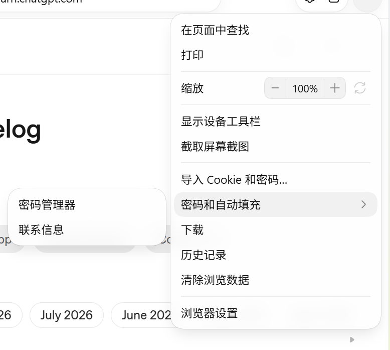

# 原生界面与菜单定制规划

日期：2026-11-04。版本：[`45.0.0-cloudbypass.6`](https://github.com/ChengHoward/edist/releases/tag/v45.0.0-cloudbypass.6)。本轮菜单精调已完成本地验收，构建记录与截图见[实现与测试](./原生界面定制实现与测试.md)，安装验证及附件见该版本发布记录。

本轮包括网站信息面板、NativePanel 控件与样式增强、地址栏建议、下载面板、悬浮输入面板，以及独立的原生菜单定制。菜单沿用 Electron 的 Menu 与 Chromium Views 菜单体系，不使用 NativePanel 承载。

历史基线为 Windows x64 `45.0.0-cloudbypass.5`，对应源码 `be820655a575d70115a93709dce527dc24150754`。该版的真实能力与验收见 [原生浮层与网站信息](./原生浮层.md)。本文新增能力包含在 Windows x64 `.6` 中，不能据此判断已发布的 `.5` 支持；实现与实测记录见 [原生界面定制实现与测试](./原生界面定制实现与测试.md)。Linux x64 仍为已有 `.2`，本次没有 Linux 或 macOS `.6` 包。

## 1. 范围与实现边界

- 工作范围限定为 Electron 定制源码、Chromium 适配与补丁、资源、公开类型、测试和文档。应用项目保持独立，由宿主提供数据与业务动作。
- 首轮实现与验收目标为 Windows x64；其他平台需单独声明能力和验证结果。
- NativePanel 和弹出菜单使用原生 Views，不为展示它们创建 WebContents、DOM、CSS 文档或额外网页渲染器。
- 打开面板或菜单不触发网页截图占位、重载、Agent 暂停、输入保护解除或隐式业务动作。
- 本轮不新增 Cookie 管理、密码库、下载管理器、搜索服务或完整浏览器设置。参考图中的菜单标签只代表业务入口。
- 完整网站权限设置页单独列为待定范围；网站设置入口继续发出已有事件。
- 已发布 `.5` 的验收记录与本轮需求分开维护。本轮按 Windows `.6` 记录对应源码、二进制、类型和测试结果。

## 2. 网站信息与语言

### 2.1 界面与交互

保留 `webContents.showPageInfoDialog(options)` 签名，按参考图实现以下流程：

1. 主面板显示域名、关闭按钮、带状态图标的连接安全入口，以及网站设置入口。
2. 安全子页具有返回、关闭、域名、安全状态说明、帮助链接和证书入口。
3. 证书查看器显示真实证书的基本信息、详细字段与证书链，不只显示几行摘要。

复用可抽离的 Chromium Page Info Views、图标、排版与交互，适配 Electron 的宿主、页面安全数据和生命周期。Chromium 原版页面依赖 Chrome Profile 与其他浏览器服务，不能把 Electron BrowserContext 直接当作 Chrome Profile。

继续从已提交文档读取安全状态与证书，保留导航、重载、移窗、权限查询重入、安全状态变化和迟到动作检查。HTTP、证书错误、混合内容与未知状态分别显示，不能仅凭 HTTPS URL 显示安全。

网站设置继续使用 `page-info-open-site-settings`，由宿主处理对应站点。图中的完整网站设置页及其权限持久化、重置和生效机制尚未纳入本轮确定范围。

### 2.2 本地化

- 内置文案跟随 Electron 应用语言，复用 Chromium 已有的字符串资源和语言资源包；有对应资源的文案不另写中英文映射表。
- Electron 已有 `--lang` 和 `app.getLocale()`，本轮不新增平行的应用语言 API。语言资源需随发行包正确打包。
- 新增的 Electron 专属说明补入本地化资源，明确不支持的语言如何回退。
- NativePanel 的自定义标题、文件状态和业务菜单标签由宿主提供翻译后的文字；应用语言参数不会自动翻译任意传入字符串。
- 应用语言变化按启动语言机制处理；宿主自定义文字可以通过更新接口刷新。不能把任意运行时改文案等同于切换了整个 Chromium 的资源语言。
- 验证中文、英文、长文本和从右向左语言的布局、键盘方向及子菜单展开方向。

### 2.3 复用 Chromium 证书查看器

按用户后续要求，证书窗口改为复用 Chromium `chrome://view-cert` 的 HTML、CSS、TypeScript、树控件与 GRIT 语言资源，使用通用 WebDialog 承载。撤下先前用 NativePanel 顺序排列证书字段的复刻，不再重做证书详情树。

将 Chromium 原有证书数据组装逻辑抽成共享模块，由 Chrome 与 Electron 共用；资源初始化改为接收 BrowserContext，避免依赖 Chrome Profile。保留基本信息、证书层次树、字段树、字段值及证书导出，宿主只适配窗口、安全数据和文件选择。

证书窗口明确增加一个专用 WebUI WebContents 与所需渲染资源。它不运行 Node 或宿主 preload，不加载网页提供的 HTML；导航、页面销毁或原面板失效时关闭。地址建议、下载面板、悬浮输入和菜单仍按原定无额外 WebContents 的边界实现。

滚动条与详细布局补充参考：[Chromium 证书详细信息](./images/native-ui-plan-2026-11/certificate-details-scrollbars.png)。NativePanel 的列表与外层溢出区统一采用 15 DIP 浅色轨道、灰色圆头滑块和上下箭头，保留原生拖动、按住连续滚动、翻页及滚轮行为；深色主题另配颜色。证书 WebUI 使用 Chromium 自身的滚动区域和样式。

参考：[主面板](./images/native-ui-plan-2026-11/page-info-main.png)、[安全子页](./images/native-ui-plan-2026-11/page-info-security.png)、[证书查看器](./images/native-ui-plan-2026-11/certificate-viewer.png)。[完整网站设置页](./images/native-ui-plan-2026-11/site-settings-reference.png)仅保留为待定范围参考。

## 3. NativePanel 控件与样式增强

### 3.1 当前限制

`.5` 已有行列布局、文本、图标、按钮、开关、输入、选项、滚动列表、分隔线和进度条。当前 `button` 使用默认原生圆角按钮；`row` 与 `list` 是布局容器，没有整行激活与列表选择语义。面板级 `radius` 不能替代控件圆角配置。

本轮将可点击内容从默认圆角按钮扩展为适合菜单式操作、下载项和地址建议的原生控件。旧按钮的默认表现保持兼容，新表现通过明确的控件与样式配置启用。

### 3.2 控件和样式

- 增加可点击列表行，支持图标、主标题、副标题、右侧状态和多个操作按钮。
- 增加纯图标按钮，以及图标与文字组合按钮；提供可访问性名称、提示、禁用与焦点状态。
- 补充普通、无边框、透明背景等按钮表现，不把每个列表项绘制为圆角按钮。
- 控件级配置补齐背景、边框、圆角、分方向内边距、对齐、字体粗细，以及正常、悬停、选中、按下和禁用状态。
- 输入框支持无边框与透明背景，能融入胶囊形外框；同时保留正常的光标、选区、焦点提示与输入法行为。
- 文本支持单行省略、主副文字布局和明确的高亮片段，用于标题中的关键词加粗。长文字不能挤出右侧按钮。
- 列表行中的按钮与整行分别命中。点击文件夹或更多按钮不能同时激活整行。
- 控件描述继续使用有限、可校验的数据字段，不接受任意 HTML、CSS 或可执行脚本。

### 3.3 选择、更新与生命周期

选中项变化与执行动作分开：悬停、方向键移动选中项不直接打开页面或文件；点击或 Enter 才执行显式动作。列表支持选中项自动滚入可见区域。

`panel.update(patch)` 承载内容、样式及列表选择控制的增强。保留稳定 id 的控件焦点、未提交文字、IME 组合输入和滚动位置；非法 patch 在原生状态改变前整体拒绝。

`new NativePanel`、`isSupported`、`show`、`update`、`hide`、`destroy` 继续作为已有入口，本轮字段冻结为 `item`、`iconButton`、`style`、`maxWidth`、`singleLine`、`highlights`、`linkRange`、`selected`、`variant` 和 `contentInset`，详见公开 API 文档。`linkRange` 用于安全说明中的原生行内帮助链接。`action`、`dismissed`、`closed` 沿用，补齐新控件的动作约定；程序更新不得冒充用户执行。

## 4. 需要覆盖的 NativePanel 场景

### 4.1 地址栏建议

按 [地址栏建议参考图](./images/native-ui-plan-2026-11/address-suggestions.png) 实现搜索项、网站图标、标题、辅助网址、关键词加粗、单行省略与选中背景。

按 2026-11-04 补充的[完整地址建议参考](./images/native-ui-plan-2026-11/address-suggestions-details.png)验收：面板与地址输入框左边和宽度对齐；标题按自然宽度显示，后面紧跟浅灰网址；长标题限制最大宽度并省略，网址使用剩余空间；选中行内缩圆角，右侧删除按钮预留独立命中区，删除不执行建议；仅网址条目允许整行使用辅助文字颜色。

输入焦点和选区留在地址栏，地址栏的键盘事件驱动列表选择、自动滚动和确认。支持上下键、Enter、Esc；输入法候选期间优先处理输入法操作，避免提前确认或关闭。搜索数据、历史记录、异步结果次序和页面跳转由宿主提供。

面板跟随地址栏锚点和可用屏幕空间调整，持续更新不跳动选中项或列表位置。

### 4.2 下载面板

按 [下载面板参考图](./images/native-ui-plan-2026-11/downloads.png) 实现标题、文件夹入口、文件图标圆角底色、文件名、大小与时间等辅助信息、状态、进度和右侧图标按钮。

下载中、暂停、完成、失败和取消等状态由宿主提供，打开文件、定位文件、继续、暂停、取消与更多操作由宿主执行。进度刷新保留滚动、悬停和焦点，隐藏面板本身不触发暂停下载。

按窗口创建下载面板，避免把跨页面的下载入口绑定到某个标签页的 `sourceWebContents`，导致页面导航时失效。

### 4.3 悬浮输入

按 [悬浮输入参考图](./images/native-ui-plan-2026-11/floating-comment.png) 实现胶囊外框、无边框输入、占位文字和麦克风图标按钮。支持中文输入法、Enter 提交、Esc 收起、失焦行为和有效焦点恢复。

宿主提供选区或按钮的屏幕锚点，负责蓝色选区和标记、原选区保存与恢复、评论业务、录音及语音识别。面板回传显式操作，不自动修改网页文档。

## 5. 菜单使用独立原生实现

### 5.1 可行性结论

Windows 的 Electron `Menu.popup()` 已经通过 `MenuViews` 使用 Chromium `views::MenuRunner`。Chromium 自己的浏览器菜单也使用 `MenuItemView`，并在普通菜单项中放入 `ZoomView` 等原生子控件。

本轮沿现有 Menu 体系实现外观、子菜单和行内按钮，尽量还原本次参考图。通过单次弹出的外观配置及有限的行内控件描述扩展已有 API；菜单仍由 Chromium MenuRunner 管理。

主菜单参考：

子菜单参考：

### 5.2 视觉要求

- 对齐主菜单的宽度、外框圆角、细边框、轻阴影、上下留白、字体和文字起点。
- 普通项保持统一行高；悬停背景在菜单内部留出左右间距，使用参考图中的浅灰色与圆角，不画整行按钮边框。
- 分隔线有自己的左右缩进、颜色与上下间距，普通项和分组之间不靠堆叠空白菜单项实现。
- 保留有图标与无图标两种排列。无图标菜单不强行占用一个空图标列；有图标菜单可参考 [图文菜单](./images/native-ui-plan-2026-11/menu-icons.png)。
- 子菜单继承配色、字体和圆角；可有独立宽度。对齐对应父项，空间不足时向另一侧展开并避让工作区。
- 子菜单箭头的大小、颜色、位置、悬停状态和键盘展开行为与参考图对齐。
- 自定义菜单正文和行内文字使用灰度抗锯齿，去除 LCD 子像素彩边；子菜单箭头、复选框和单选框使用现代 Chromium 图标，不受全局旧图标开关影响。
- 有图标的菜单使用 18 DIP 图标列和 8 DIP 文图间距。复选框或单选框同时具有业务图标时，整组菜单统一预留勾选槽与图标槽，所有正文对齐；无图标和勾选项时不占空列。
- 浅色参考图作为首个对齐目标；补齐深色与系统主题，分开记录主题差异。

两张原图分别为 466 × 653 和 778 × 697 像素。原图中常见背景色约为 `#FFFEFF`，悬停背景约为 `#F2F1F2`；这些只是截图采样值，不能代替真实主题令牌，也不能把图片像素直接当作 DIP。实现时在记录过缩放、字体与语言的环境中校准尺寸和颜色。

目标是同等环境下尽量像素对齐。不同字体、DPI、主题、文字内容和系统合成的结果要分别验收，不预先宣称所有环境逐像素相同。

### 5.3 缩放组合控件

增加可承载原生行内控件的菜单项：左侧“缩放”，右侧为减号、百分比、加号组成的圆角分段区域，旁边有独立重置图标。

- 减号、加号与重置分别命中并回传动作，不能触发行本身的其他动作。
- 连续点击增减时菜单保持打开，百分比和可用状态即时更新；普通命令默认仍按原生菜单规则关闭。
- 到达最小、最大或默认值时，宿主能够更新对应按钮的禁用状态。截图中的重置按钮与 Chromium 原版 ZoomView 的全屏按钮含义不同，不能直接照搬原命令。
- Tab、Shift+Tab、方向键、Enter、Space 与 Esc 在行内按钮和菜单层级间有确定行为，保留原生可访问性。
- 控件值与操作可以由宿主提供和执行。若设计内置网页缩放绑定，必须校验目标页面及所属窗口，不能误操作另一个窗口或已切换的标签页。
- 原生控件只覆盖本菜单所需的按钮、标签和图标，不将 Menu 变成任意网页或 NativePanel 内容的容器。

### 5.4 已冻结的菜单接口

扩展现有 `Menu.buildFromTemplate`、`MenuItem` 与 `menu.popup(options)`，不代表已发布 `.5` 支持：

- `menu.popup({ appearance })` 增加 `theme`、`width`、`submenuWidth`、`fontFamily`、`fontSize`、`rowHeight`、`radius`、`itemRadius`、`padding`、`itemPadding`、`separatorInset`、`separatorSpacing` 和四项颜色。子菜单继承同一弹出的外观，使用统一的子菜单最小宽度；本轮不提供任意子菜单局部样式覆盖。
- `MenuItem.controls` 描述 1 至 8 个 `button` 或 `label`；字段包括 `id`、`label`、`icon`、`accessibleName`、`enabled`、`closeOnClick` 和 `group`，承载缩放组合行。操作通过根 Menu 的 `control-action` 回传 `{ itemId, controlId }`，不带 Electron event 参数。
- 保留现有 `label`、`enabled`、`visible`、`checked`、`icon`、`submenu`、快捷键及回调语义。菜单打开期间的值与按钮状态需要模型通知和局部刷新，不能仅修改对象字段后假定画面已更新。
- 打开期间替换控件值后调用 `menu.refresh()`。刷新先校验全部内容再更新；当前弹出中的行、id、类型及分组保持稳定。不增加平行的菜单创建与销毁方法。
- 现有 `popup` 的 `x`、`y` 维持窗口内容区相对 DIP 约定。若补充锚点矩形，必须明确坐标空间，不能与 NativePanel 的屏幕 DIP 混用。
- 行内按钮的个数、顺序、文字、图标、分组、禁用和关闭行为可配置；单按钮 24 × 24 DIP、标签 44 × 24 DIP、图标 18 × 18 DIP、分段圆角 8 DIP 和组后 4 DIP 间隔为本轮内置尺寸。标签字号比菜单小 1 DIP，最低 6 DIP，不提供任意子控件 CSS。
- `itemPadding` 为行内总水平留白，不含外层 `padding`，也不叠加系统菜单原有的 8 DIP 组件间距。分隔线颜色由 `border` 与 `background` 各半混合，分段边框另行派生。`border` 作为默认边框绘制路径及分隔线、分段轮廓的基色；Windows 气泡菜单外层细线由 Chromium BubbleBorder 主题绘制，不能保证 `border` 精确覆盖所有外框路径。
- `menu.closePopup()` 沿用。未指定新外观时继续使用现有菜单行为；不支持的新选项需要可查询的能力或明确错误，不能静默声称已应用。

### 5.5 原生实现与隔离

以 Electron 自有菜单适配器构建 `MenuItemView` 树，再交给 `MenuRunner` 管理显示、捕获、选择、子菜单与关闭。已有 Chromium 菜单控件和浏览器缩放行提供实现参考；不直接引入整个 Chrome AppMenu 及其 Profile、浏览器窗口和其他业务依赖。

菜单外观属于单个菜单实例及其子菜单树。不能修改进程级 `MenuConfig::instance()` 来统一影响其他窗口、默认菜单、DevTools 或已有控件的下拉菜单。

Windows 普通菜单的自定义圆角、布局与颜色有部分参数未通过现有 Menu API 暴露；需使用适配器或最小的 Chromium 扩展。`MenuRunner` 头文件对自定义 corners 参数存在 Ash 系统布局限制，不能假设传入一个圆角值便已解决 Windows 普通菜单外观，也不能为此伪装成 Ash 菜单。

菜单关闭、窗口销毁、回调重入、父菜单与子菜单交替开关都必须正确释放适配器、原生控件和监听；现有菜单对象在弹出期间的存活保证继续保留。

## 6. 源码核查入口

本节为本轮 checkout 中的实现与参考入口：

- `lib/browser/api/native-panel.ts` 与 `shell/browser/ui/views/native_panel.cc`：现有 schema、默认按钮、布局、更新、焦点与输入法处理。
- `lib/browser/api/web-contents.ts`、`lib/browser/api/page-info.ts` 和 `shell/browser/ui/views/native_page_info.cc`：PageInfo 原生布局、Chromium GRIT 文案与真实证书模型。
- `shell/browser/api/electron_api_menu_views.cc` 与 `shell/browser/ui/views/native_menu.cc`：MenuRunner 的单次外观、行内控件、刷新及生命周期。
- `shell/browser/api/electron_api_menu_item.cc` 与 `shell/browser/ui/electron_menu_model.*`：菜单项属性与模型，需要补齐打开期间的局部更新通知。
- Chromium `ui/views/controls/menu/menu_item_view.h`：菜单背景、选中颜色、边距及子控件能力。
- Chromium `ui/views/controls/menu/submenu_view.h` 与 `menu_config.h`：子菜单宽度、分隔线与全局配置边界。
- Chromium `ui/views/controls/menu/menu_runner.h`：自定义菜单树构造与圆角参数的现有限制。
- Chromium `chrome/browser/ui/views/toolbar/app_menu.cc`：浏览器菜单嵌入 ZoomView、按钮与标签的实现参考。
- Chromium `chrome/browser/ui/views/page_info/`、`components/page_info/` 与 `chrome/browser/ui/webui/certificate_viewer/`：PageInfo、语言资源引用和原版证书查看器路径。

## 7. 实施顺序与交付

1. 冻结有限的控件、样式与动作 schema，明确 NativePanel 和 Menu 各自的职责、语言策略、平台能力及证书查看器路线。
2. 实现 NativePanel 的列表行、图标按钮、输入样式、文字排版与选择控制，用下载、地址建议和悬浮输入三组场景验收。
3. 对齐网站信息主面板、安全子页、证书查看器与本地化，继续验证真实安全数据和文档身份。
4. 独立实现 Menu 外观、子菜单和行内缩放控件，以本次两张菜单截图作为主要视觉验收参考。
5. 完成源码构建、公开类型、实机交互与回归后，交付真实运行截图、测试记录及 Windows `.6` 发行包。本地镜像实际安装后的运行、公开类型及三项定向 UI 检查已通过；GitHub 附件、安装验证和校验值见 [版本发布记录](https://github.com/ChengHoward/edist/releases/tag/v45.0.0-cloudbypass.6)。

## 8. 验收要求

- 为三个 NativePanel 场景、PageInfo 流程和原生菜单分别保存基准截图，记录二进制 SHA、系统、字体、语言、缩放和主题。
- 菜单视觉检查覆盖默认、悬停、按下、禁用、子菜单打开、反向展开与缩放控件更新。测量外框、文字起点、行高、留白、分隔线和按钮位置。
- 实测原始鼠标点击、连续按钮点击、键盘导航、中文输入法、焦点恢复、内外部点击、透明边缘和屏幕边缘，不能以属性存在或隐藏窗口断言替代。
- 菜单不得实例化 NativePanel；原生面板和菜单不得新增 WebContents 或网页渲染器。证书查看器若选择独立 WebUI 路线，按第 2.3 节单独记录。
- 在打开菜单或面板时验证底层网页持续绘制、既有 Agent 输入与真实输入保护保持正确，不能隐式暂停或解除保护。
- 验证稳定 id 更新、选中项与滚动保留、嵌套按钮不冒泡执行、非法配置整体拒绝、异步数据更新、重复显示、快速关闭及资源释放。
- 多窗口、多显示器与混合 DPI 分别列出实测条件。没有设备时明确记录边界，不把单显示器结果扩展为全部硬件已通过。
- 回归 `.5` 已有七入口、默认按钮、普通原生菜单、子菜单、快捷键、勾选项与 radio 分组，不以新样式破坏旧行为。
- 本次交付实现、编译、测试、文档、实机截图及 Windows `.6` 发行包，按实际平台分别记录安装与发布验证。
